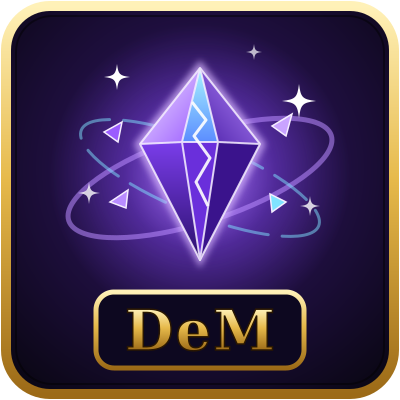
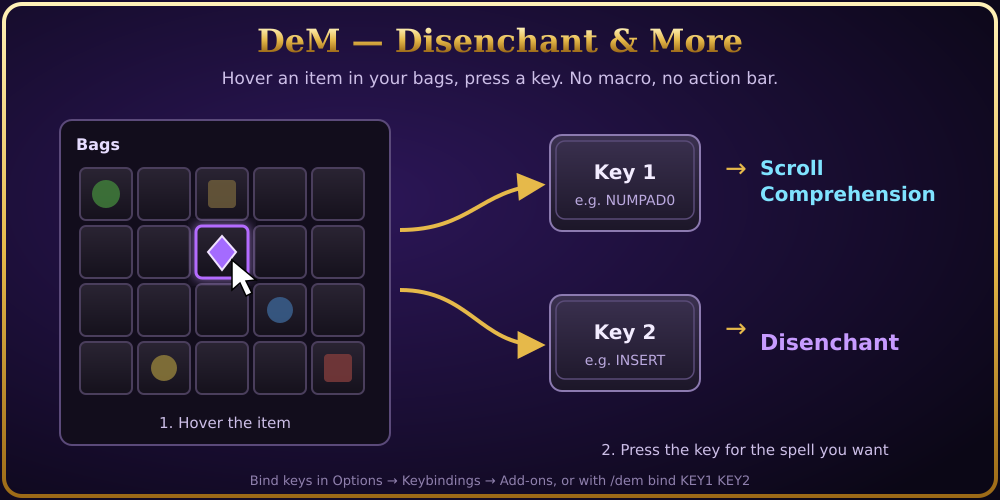

# DeM — Disenchant & More
 


**English** | [Français](#français)

**DeM** (*Disenchant & More*) is a small World of Warcraft **Forever** addon: hover an item in your bags and press a key to cast **Scroll Comprehension** (*Compréhension de parchemin*) or **Disenchant** (*Désenchanter*) on it.

## Why?

The usual macro trick (`/cast` + `/click` on the hovered item) does not work well on WoW Forever:

- macros are limited to 255 characters and can no longer be chained or extended by addons;
- with a `[mod:shift]` macro, action bar addons such as ElvUI can swallow the Shift press;
- many gaming mice send **Numpad 0**, which Windows turns into **Insert** when Shift is held — so the game never sees "Shift".

DeM avoids all of this: no macro, no action bar. Each spell has **its own key binding**, linked to a hidden secure button that uses the hovered bag slot directly.

## Installation

1. Download the latest `Disenchant-and-More-x.y.z.zip` from the [Releases](../../releases) page.
2. Extract it into `World of Warcraft\_forever_\Interface\AddOns\` — you should get `AddOns\DeM\DeM.toc`.
3. Restart the game (a `/reload` does not detect a new addon folder).

> Do not use GitHub's *Code → Download ZIP*: it creates a `Disenchant-and-More-main` folder, and WoW only loads the addon if its folder is named exactly `DeM`.

## Configuration

Bind the two actions, either:

- **In the menu:** `Esc` → *Options* → *Keybindings* → *Add-ons*:
  - *Compréhension de parchemin sur l'objet survolé*
  - *Désenchanter sur l'objet survolé*
- **Or with a command:**
  ```
  /dem bind KEY1 KEY2
  ```
  `KEY1` casts Scroll Comprehension, `KEY2` casts Disenchant. Example for a mouse button sending Numpad 0 (and Insert with Shift):
  ```
  /dem bind NUMPAD0 INSERT
  ```

Not sure what your mouse button sends? Type `/dem` to toggle debug mode: every key you press is printed in the chat. Type `/dem` again to turn it off.

## Usage

Hover an item in your bags (default bags, ElvUI bags…) and press the key. Out of combat only.

## Changing the spells

The spells are defined at the top of `DeM.lua`:

```lua
local SPELL_1 = "Compréhension de parchemin"
local SPELL_2 = "Désenchanter"
```

Use the spell names of your client language.

## Commands

| Command | Effect |
|---|---|
| `/dem` | Toggle debug messages (shows pressed keys and actions) |
| `/dem bind K1 K2` | Bind `K1` to spell 1 and `K2` to spell 2 |

---

# Français

[English](#dem--disenchant--more) | **Français**

**DeM** (*Disenchant & More*) est un petit addon pour World of Warcraft **Forever** : survolez un objet dans vos sacs et appuyez sur une touche pour lancer **Compréhension de parchemin** ou **Désenchanter** dessus.

## Pourquoi ?

L'astuce classique avec une macro (`/cast` + `/click` sur l'objet survolé) fonctionne mal sur WoW Forever :

- les macros sont limitées à 255 caractères et ne peuvent plus être enchaînées ni étendues par un addon ;
- avec une macro `[mod:shift]`, les addons de barres d'action comme ElvUI peuvent bloquer l'appui avec Shift ;
- beaucoup de souris gaming envoient **0 du pavé numérique**, que Windows transforme en **Inser** quand Shift est enfoncé : le jeu ne voit donc jamais « Shift ».

DeM contourne tout ça : ni macro, ni barre d'action. Chaque sort a **son propre raccourci clavier**, relié à un bouton sécurisé caché qui utilise directement l'emplacement du sac survolé.

## Installation

1. Téléchargez le dernier `Disenchant-and-More-x.y.z.zip` depuis la page [Releases](../../releases).
2. Décompressez-le dans `World of Warcraft\_forever_\Interface\AddOns\` : vous devez obtenir `AddOns\DeM\DeM.toc`.
3. Relancez le jeu (un `/reload` ne détecte pas un nouveau dossier d'addon).

> N'utilisez pas *Code → Download ZIP* de GitHub : il crée un dossier `Disenchant-and-More-main`, et WoW ne charge l'addon que si son dossier s'appelle exactement `DeM`.

## Configuration

Associez les deux actions :

- **Dans le menu :** `Échap` → *Options* → *Raccourcis clavier* → *Add-ons* :
  - *Compréhension de parchemin sur l'objet survolé*
  - *Désenchanter sur l'objet survolé*
- **Ou avec une commande :**
  ```
  /dem bind TOUCHE1 TOUCHE2
  ```
  `TOUCHE1` lance Compréhension de parchemin, `TOUCHE2` lance Désenchanter. Exemple pour un bouton de souris qui envoie 0 du pavé numérique (et Inser avec Shift) :
  ```
  /dem bind NUMPAD0 INSERT
  ```

Vous ne savez pas ce qu'envoie votre bouton de souris ? Tapez `/dem` pour activer le mode diagnostic : chaque touche pressée s'affiche dans le chat. Retapez `/dem` pour le couper.

## Utilisation

Survolez un objet dans vos sacs (sacs par défaut, sacs ElvUI…) et appuyez sur la touche. Hors combat uniquement.

## Changer les sorts

Les sorts sont définis en haut de `DeM.lua` :

```lua
local SPELL_1 = "Compréhension de parchemin"
local SPELL_2 = "Désenchanter"
```

Utilisez les noms des sorts dans la langue de votre client.

## Commandes

| Commande | Effet |
|---|---|
| `/dem` | Active/désactive les messages de diagnostic (touches pressées et actions) |
| `/dem bind T1 T2` | Associe `T1` au sort 1 et `T2` au sort 2 |
